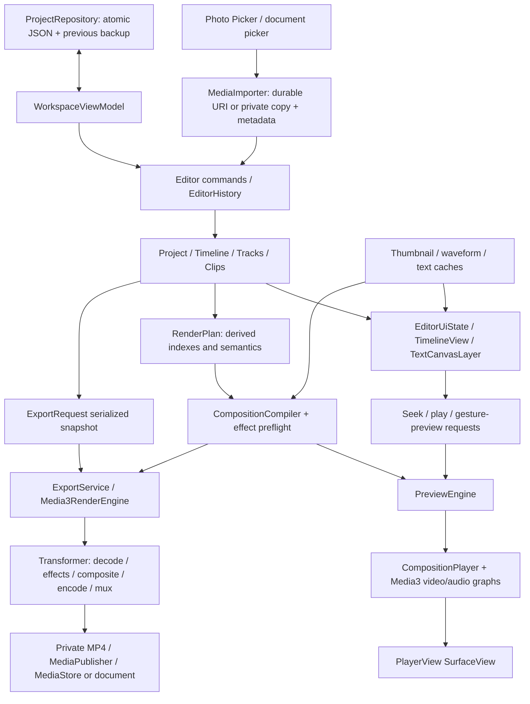
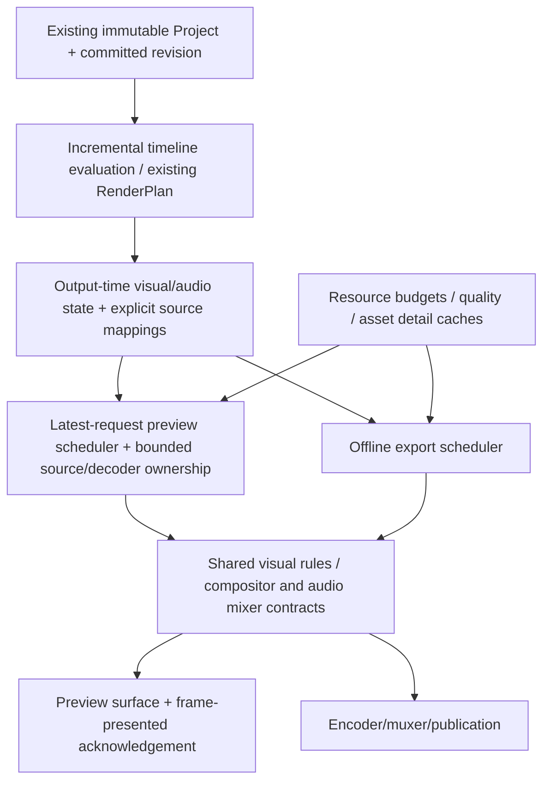

# 1. Executive Summary

Audit date: 28 October 2026. Source revision: `6bf570ab0c6bb4abec87321ee61136ef729067f9`. Scope: discovery, code tracing, runtime measurements and verification only. No production fixes, features or architecture changes were made.

Frame Studio has a working non-destructive editing foundation, not merely UI scaffolding: commands/history, persistence/import, multitrack timelines, native preview/export, text, real color effects and runtime media-transform properties. The central limitation is **interactive preview execution and decoder/graph lifecycle**, especially when scrubbing layered or animated content. A canonical derived plan already exists; replacing the document/history system would not address the measured bottleneck.

Key results:

- All **53 JVM tests and 36 existing instrumentation tests passed**. Debug/release builds passed; lint reported **0 errors and 26 warnings**.
- In a 120-request seek probe, simple preview retained one player; layered and animated preview each used **31 player instances**. Individual main-thread seek bodies reached **103 ms and 114 ms**, respectively. Compilation of the small repeated-source graphs took 8–12 ms in that run.
- Timeline-only measurements covered 1/10/25/50/100 clips **per track**, across VIDEO/OVERLAY/AUDIO/TEXT: up to 400 document clips. Frame costs were non-monotonic; the measurements do not establish a clip-count-only cause for jank.
- A real synthetic **3840×2160 H.264 source imported and displayed correctly** on the emulator. Native logs identify `c2.goldfish.h264.decoder` processing the original 3840×2160 format. A 2160p export request fell back to **1920×1080**. Sustained/high-bitrate/4K60/multilayer/physical-device behavior remains unverified.
- A disposable persistence probe confirmed that loading an unsupported future-schema document can **overwrite it with an older compatible backup**. This is a conditional but real data-loss defect, left unfixed as required by the audit scope.

Evidence labels throughout: **TEST** = assertions in executed tests; **PROFILE** = measurements from temporary audit probes; **TRACE** = current source/dependency implementation; **RISK** = inference; **UNKNOWN / NOT MEASURED** = no adequate runtime evidence. References `[E01]` etc. resolve in section 45. Historical reports were used as navigation aids, not accepted as current implementation proof.

# 2. Current Architecture

Two Gradle modules: pure Kotlin/JVM `:core` and Android/Compose `:app`. Production inventory: **5 core Kotlin files / 873 lines**, **29 app Kotlin files / 4,055 lines**. Permanent test inventory: 4 core JVM files, 4 app JVM files, 13 instrumentation test classes plus the fixture generator. There is no benchmark module, native C/C++, Vulkan, FFmpeg, application shader source, worker queue or WorkManager integration. Explicit EGL/GLES fixture generation lives in tests; production GL rendering is owned by Media3. [E01,E18]

Stack: Kotlin/Compose compiler 2.2.21, AGP 8.13.2, Gradle 8.13, JDK 17, min/compile/target SDK 26/36/36, Media3 1.11.1, coroutines 1.10.2, serialization JSON 1.9.0. Release minification is enabled; release signing is not configured. Manifest declares export foreground-service permissions/types; no internet or broad media-library read permission. [E01]

# 3. Source of Truth

| State | Authority / owner | What can drift |
|---|---|---|
| Committed edits | `EditorHistory.project`; `EditorViewModel.committedProject` exposes it | No durable command journal; recent unsaved edits can be lost on process death |
| Gesture preview | Command applied to `gestureBase`, published as `EditorUiState.project` | Deliberately differs from committed history until finish/cancel |
| Selection / text-edit target | `EditorUiState` IDs | Transient; pruned when a clip disappears; not persisted |
| Timeline center / playhead | `EditorUiState.positionUs` | Also held in PreviewState and native player milliseconds |
| Native transport | `PreviewEngine` requested-playing flag, generation and CompositionPlayer | Play intent, buffering, native `isPlaying` and visible frame are different states |
| Render plan | Derived snapshot references/indexes | Can reference the preceding snapshot during a pending compilation; generation prevents applying obsolete output |
| Export | Serialized `ExportRequest.project` | Isolated from later editing after request serialization; not resumable |
| Project library / save status | Workspace and repository | Library loads complete documents; no separately indexed project summaries |

Gesture start retains the committed base and pauses playback. Every gesture preview is a pure command application against that base. Finish executes one history command; cancel publishes committed history without autosave notification. Autosave observes committed publication; `flush()` explicitly uses `committedProject`. Closing cancels gestures before saving. These distinctions are intentional and should be preserved. [E02,E03,E04]

ExportScreen receives the current UI project, whereas `flush()` saves the committed project. Ordinary toolbar use does not establish a reproduced mismatch, but there is no explicit export API contract requiring a committed revision. Concurrent gesture/import/export entry points need adversarial coverage before calling the snapshot boundary airtight. **RISK**, not a reproduced lost-edit incident. [E03,E04,E12]

# 4. Complete Editing Pipeline

| Stage | Actual classes/functions | Thread, ownership and costs |
|---|---|---|
| Select/import | MainActivity launchers → `WorkspaceViewModel.importMedia` | Main orchestration; workspace-owned job; picker cancellation/import concurrency guards |
| Acquire/probe | `MediaImporter.importMedia`, `hasPersistentAccess`, `copyCancellable`, `readAudioVideo`, `readImage` | IO; application context; persisted grant or private copy; Extractor/Retriever/EXIF; synchronous platform calls are not immediately cancellable |
| Add/edit | `AddClips` / other commands → `EditorHistory.execute` | Main; copies affected lists and validates whole project; history bounded to 100 snapshots |
| Publish/save | `EditorViewModel.publish` → workspace callback → repository | Main state publication; 300 ms autosave debounce; validation/JSON/backup/file operations on IO |
| Draw timeline | `EditorScreen` → `TimelineView` → visible `TimelineTrack` children | Main Compose/layout/draw; indexed visible clips; source caches run independently |
| Request preview | Editor callbacks and MainActivity LaunchedEffects | Main; every horizontal pointer update can issue a seek; project edits request compilation |
| Plan/compile | `RenderPlan.derive` → `CompositionCompiler.compile` | Default for validation/indexes/graph construction; IO source-access checks; fresh runtime processors/effects |
| Decode/display | `PreviewEngine.createPlayer` → CompositionPlayer → sequence players → video graph → PlayerView | Public player calls Main; internal playback/codec/GL threads own streaming resources |
| Export snapshot | ExportScreen → ExportCoordinator request JSON | Background preflight/IO; service starts only after preparation succeeds |
| Render/publish | ExportService → Media3RenderEngine → compiler → Transformer → MediaPublisher | Foreground service scope on Main; codec/GL/muxing internal; publication IO; cancellation cleanup in finally |

Source media is never overwritten. Output is encoded into a private temporary MP4 before publication. Atomic project saves and completed-output publication solve different durability problems. [E03–E13]

# 5. Project Model Assessment

**Strong:** Long microsecond times, half-open clip membership, validated finite transforms/speed/gain, explicit media references, pure commands, bounded undo, exact split-duration override plus fractional source offset, schema-1-to-2 migration, and source-time keyframes. [E02]

**Immutability qualification:** Kotlin `val`/read-only List/Map APIs are used consistently by production editing code; collections are not defensively copied into persistent immutable collections. External callers can supply mutable backing collections. Snapshot safety depends on the existing ownership convention.

Project validation sorts each track, checks IDs/references/types/source bounds and forbids overlap **within a track**. Track order defines stacking; muting affects audio and locking affects editing. Image virtual duration is distinct from intrinsic media duration. Effects/transitions are string-identified schemas; general document validation does not validate all backend capabilities. Render preflight is a separate boundary. [E02,E08]

Limitations for future work:

- No same-track overlap/transition handles, linked/grouped clips, nesting, adjustment layers or blend modes.
- Constant scalar speed; no integrated piecewise time mapping for speed ramps.
- Positive scale excludes mirror/flip; no crop/mask/source-geometry representation.
- Effect parameter and property names are strings/Float maps, not a typed parameter schema.
- Transition model validation checks duration and referenced IDs, not a complete valid two-input schedule.
- Media metadata omits explicit HDR/color-space/VFR/timebase/profile/source-version identity.
- Canvas FPS is integer; rational 23.976/29.97/59.94 is not represented.

These are bounded extension/migration requirements, not evidence that Project/Timeline/history should be replaced.

# 6. Timeline Architecture

`TimelineView` owns a stable parent pointer handler, time-centered viewport, local zoom, LazyColumn track state, fling job, snap target and dragged ID. The horizontal center is the editor playhead; there is no independent horizontal browse offset. Playback therefore moves the same viewport that scrubbing moves. [E05,E06]

One horizontal pointer update follows this path:

1. Parent `pointerInput` receives movement; touch slop selects horizontal versus vertical behavior.
2. `TimelineViewport.pan` converts pixel delta using Double scale to Long microseconds.
3. `editor.seek()` pauses play intent, copies EditorUiState, clamps using timeline duration, and invokes the native seek callback.
4. EditorScreen and EditorSession collectors observe state; the timeline constructs a new viewport.
5. Existing track indexes are reused while track data is unchanged. Each visible lane binary-searches its time range with a 60-pixel margin.
6. Visible clip boxes change offset/visible width; ruler, semantics/labels and waveform coordinates update; thumbnail producers restart only when their keys change.
7. Native seek processing proceeds independently, but synchronous player calls still occur on Main. Slow calls can delay the next pointer/state update.

A clip move/trim adds substantially more work: derive delta/snap tolerance → rebuild all snap endpoints → scan collision/neighbors → construct a command → apply/validate against the gesture base → publish a temporary project → rebuild timeline indexes for changed track-list data → request preview compilation. Horizontal edit autoscroll repeats this work on approximately 16 ms timeouts. Reorder closes gaps; cross-track moves preserve source content and enforce compatibility/locks. [E02,E05,E06]

The stable parent survives clip reparenting. Pinching cancels an active edit and preserves the focal timestamp; lifting one finger continues panning. Fling uses `AnimationState.animateDecay` and emits seeks each animation update. Vertical lanes scroll through LazyColumn. Selected tracks can auto-scroll into view; there is no equivalent vertical edge-autoscroll during cross-track dragging.

# 7. Timeline Performance

**PROFILE methodology:** temporary test-only instrumentation, debug APK, ARM64 Pixel 5 Android 17/API 37 emulator. Each document had four tracks, with N clips per track, repeated short synthetic video/audio sources, one-second clips spaced every two seconds. At most visible lanes/clips were drawn; not all four lanes were necessarily visible simultaneously. Native preview was detached for the UI experiment. Assets were toggled between absent and real thumbnail/waveform repositories. Cache reuse across cases means this is not a cold-cache/unique-media stress test.

Compose pointer input supplied 120 paced horizontal moves along a sinusoidal path, followed by release; test synchronization waited for idleness between injections. **This is not a Macrobenchmark or unconstrained physical 60 Hz gesture.** FrameMetrics reports actual window frame durations, but test scheduling, debug/JIT and emulator rendering affect them. Wall-time/120 is not an application FPS measurement. PSS is a point sample, not peak GPU/decoder memory.

| Clips/track (total) | Assets | Frames | p50 / p95 / max ms | Main CPU ms | Allocated MiB / GC | Thumbnail requests |
|---|---|---|---|---|---|---|
| 1 (4) | off | 62 | 17.28 / 18.82 / 22.89 | 1150.3 | 16.81 / 1 | 0 |
| 1 (4) | on | 62 | 17.38 / 20.70 / 23.73 | 1013.5 | 18.28 / 3 | 0 |
| 10 (40) | off | 119 | 17.37 / 21.60 / 25.99 | 1408.0 | 18.78 / 4 | 0 |
| 10 (40) | on | 119 | 22.22 / 56.69 / 147.01 | 2612.0 | 22.94 / 4 | 16 |
| 25 (100) | off | 119 | 37.52 / 107.65 / 272.58 | 3096.4 | 43.94 / 7 | 0 |
| 25 (100) | on | 119 | 17.79 / 29.90 / 51.04 | 1448.0 | 22.81 / 5 | 24 |
| 50 (200) | off | 119 | 17.37 / 22.05 / 37.08 | 1017.9 | 20.56 / 4 | 0 |
| 50 (200) | on | 119 | 17.33 / 19.72 / 27.78 | 1075.3 | 24.25 / 7 | 16 |
| 100 (400) | off | 119 | 17.33 / 19.95 / 31.50 | 975.0 | 23.47 / 11 | 0 |
| 100 (400) | on | 119 | 17.47 / 21.90 / 33.65 | 1151.5 | 25.41 / 6 | 16 |

All valid cases had zero listener drops and zero frames over 700 ms. The one-clip case clamped at project bounds and emitted only 62 measured frames; other cases produced 119. The 25-clip no-assets outlier is real in this run but not evidence of monotonic N-scaling. Do not fit a throughput curve to this table.

A separate 400-clip repeat measured 119 frames per mode:

| Mode | p50 / p95 / max total frame ms | Main CPU across gesture ms | Allocated MiB / GC count | Average draw / layout / GPU-duration ms per frame |
|---|---|---|---|---|
| No assets | 19.06 / 34.09 / 55.71 | 2576 | 22.44 / 3 | 2.56 / 0.031 / 14.83 |
| Assets | 18.73 / 41.35 / 177.58 | 2358 | 24.97 / 5 | 2.94 / 0.025 / 14.81 |

Reported deadline was 16.667 ms. All 119 frames in both repeat cases exceeded that deadline. Mean unknown-delay contributions were 3.25/3.96 ms; sync 0.116/0.114 ms; command issue 0.944/0.765 ms; swap 0.831/0.704 ms. These metrics are not necessarily additive independent stages. GPU-duration is the emulator window renderer's metric, **not profiling of the separate native video SurfaceView/compositor**.

A wrapper analogous to EditorSession observed 119 composition commits for 120 requests. Inner per-composable recomposition counts and layout invocation counts were **NOT MEASURED**. Aggregate FrameMetrics layout duration is not a count.

Domain probes on Main warmed 20 calls then timed 200 independent calls against an unchanged base. First-pass p95 at 400 clips: validate 0.541 ms, snap-target construction plus snapMove 0.699 ms, move command 0.203 ms, RenderPlan derivation 0.217 ms, duration scan 0.019 ms. Repeat p95: **4.801 / 2.393 / 0.359 / 0.666 / 0.018 ms**; snap maximum 17.873 ms. JIT/GC/environment variation is material. These are not full gesture costs and do not include every repeated validation or graph operation.

Conclusion: UI allocations/rendering and synchronous native work both matter. Validation and snapping have real scaling costs, but the first-pass data does not justify making them the sole explanation for current jank. Drag/trim/fling/zoom/playback-following have code traces and functional tests; independent performance distributions for each are **NOT MEASURED**. [E05,E06,E19]

# 8. Compose/Recomposition Findings

EditorSession, EditorScreen and TextCanvasLayer collect broad editor state. Native preview state is also collected by EditorSession; every position update can invalidate composition that also references slow project data. Playing updates arrive roughly every 33 ms, paused native polling every 100 ms. [E03,E04,E07]

| Trigger | Work invalidated / reused |
|---|---|
| Position or playback-follow | New viewport; visible range/clip positions/ruler/waveform draw mapping; unchanged track indexes reused |
| Selection | Selected clip/track scans, outlines/trim handles, track-selection scroll effect |
| Thumbnail completion | Local producer/image subtree; does not itself mutate Project |
| Waveform completion | Local producer/Canvas; arrays are per consumer copies |
| Zoom | Visible bounds, clip widths, thumbnail tile times/keys, ruler density and waveform mapping |
| Gesture project | Track-list keyed index map and text indexes can rebuild; compiler receives temporary project |
| Committed project | Same visual work plus autosave/history publication |
| Text-only transform | Compose text moves immediately; native graph skips compatible stable-duration changes |

`remember`, stable clip/track keys, and `rememberUpdatedState` are used appropriately to retain input ownership and avoid stale gesture captures. No explicit `@Stable`/`@Immutable`, `derivedStateOf` or `snapshotFlow` annotations/operators were found. This absence is not itself a defect; Kotlin/Compose skipping can skip unchanged arguments. It would be incorrect to claim every label fully recomposes on every seek without compiler/runtime data. [E03,E05,E10]

Concrete strengthening targets: separate transport/viewport subscriptions from inspector/document work; cache revision-dependent indexes/endpoints; keep frequently moving draw overlays independent where feasible. Preserve visible-clip culling and stable input ownership. A forced annotation would be unsafe if mutable backing collections remain possible.

# 9. Thumbnail Architecture

`ThumbnailStrip` computes 64 dp tile locations in clip/source time, requests at most 32 tiles per visible clip, and keys producers with media ID/tile/100 ms source buckets. Provider requests are quantized again to **250 ms**; stills use time zero. The mismatch can restart producers that ultimately address the same cache key. [E05,E09]

`ThumbnailCache.thumbnail`: clamp requested size to 8–512 → SHA-256 key over URI/size/duration/time/dimensions → memory lookup → IO → one of 16 key-striped Mutexes → disk PNG → decode semaphore → Retriever or sampled image decode → center crop → LRU → atomic PNG → periodic disk sweep. The hash/string formatting and first lookup run before switching to IO, including when called from Main-launched producers.

- Memory: heap/16 clamped to 4–32 MiB, byte-count LRU. Live Compose references can exceed cache ownership.
- Decode concurrency: 2 on API 27+, 1 on API 26. A new Retriever is opened per uncached video tile; no shared decoder/session pool or viewport-priority queue.
- API 27+: scaled-frame extraction bounds the returned bitmap, not proof that the codec never processes original-resolution frames. API 26 obtains a full frame before crop.
- Images: bounds probe, power-of-two sample, long edge limited around 2048, EXIF rotation/flip, then crop.
- Disk: 96 MiB/1,500 PNG target, swept at most once/minute after successful decode; limits can be temporarily exceeded between sweeps. Disk hits refresh access time.
- Cancellation: coroutine checks around platform work; a synchronous decode already in progress cannot be interrupted immediately. Failures return null; the UI omits thumbnails without an explicit error.

Rapid fling/zoom can abandon keyed producers and queue replacement work; striped locks deduplicate equivalent keys but also serialize unrelated colliding keys. The 400-clip warm-source gesture requested 16 thumbnails in its asset case; that is not a 100-unique-source result. One cold 4K-source 192×192 thumbnail took **3,003 ms** in the audit. A 4K60/high-bitrate/long-GOP thumbnail distribution is **UNKNOWN**. [E09,E19,E20]

# 10. Waveform Architecture

`WaveformRepository.waveform` caches a source-wide peak envelope by URI/size/duration/bucket count. A memory hit returns a copy. IO handles disk reads and one of 16 key locks; a **single decoder semaphore** serializes new source decoding. MediaExtractor feeds MediaCodec; PCM output is streamed into buckets rather than retained as a full recording. The loop checks cancellation and has a 10-second no-progress timeout. [E09]

`consumePcm` handles 8/16/24/32-bit and float PCM, preserves sample timestamps, takes the louder absolute channel, skips non-finite values and bounds peaks. UI requests 2,048 buckets, and WaveformStrip samples that envelope every 3 dp at draw time with trim/speed mapping. It does not recalculate a full envelope per frame and does not visualize gain/automation.

| Source length | Time represented by one UI bucket | PCM bytes visited if 48 kHz stereo 16-bit |
|---|---|---|
| 10 min | 0.293 s | 115.2 MB |
| 30 min | 0.879 s | 345.6 MB |
| 60 min | 1.758 s | 691.2 MB |
| 2 h | 3.516 s | 1,382.4 MB |

These are arithmetic estimates, **not measured decode times or retained allocations**. Each 2,048-float envelope is about 8 KiB. Memory LRU is 64 entries; disk targets 16 MiB/1,024 files, sorted/swept after writes. A long first decode can block other visible waveforms behind the one decoder; there is no progressive/multiresolution envelope or segment-first scheduling. Two-hour zoomed-in waveform fidelity and latency are unverified.

# 11. Preview Architecture

`PreviewEngine` is a Main-thread, lifecycle-owned controller with application context, SupervisorJob, compilation/clock/scrub jobs and generation guards. Project changes are coalesced by a 60 ms delay; Default builds/reuses RenderPlan and compiles fresh native items/effects/processors. Source opening is IO. Native graph installation and prepare are Main. [E07,E08]

Two actual paths:

- **Single input:** disjoint visual clips, identity static transforms, no clip properties, only effects advertising single-input support. Tracks flatten into a video sequence, retaining audio separately. Clock is omitted unless no visual track exists; composition-level Presentation also sizes black gap items. Text-only/audio-only use a canvas clock with a single-input graph.
- **Multiple input:** original reversed visual tracks plus a transparent primary clock and separate audio sequences. ProjectCompositor supplies transforms/alpha. A source switch can require a new native player to avoid retained frames.

Editor preview explicitly sets `renderTextInPlayer=false` and draws interactive text through Compose. Native text preview is implemented/tested but is not the normal editor adapter. Export always uses the clock-backed original visual graph and native text overlays. [E03,E07,E08,E10]

# 12. Preview Graph Lifecycle

| Condition | Actual action |
|---|---|
| First nonempty project | Compile; create graph/player; setComposition; prepare |
| Rendering edit / non-skipped gesture project | Cancel older compile; pause existing player; delay; rebuild composition |
| Existing graph is multiple-input, or graph mode changes | Release player before applying compiled graph; create replacement |
| Existing and new graph are single-input | Retain public CompositionPlayer object, but setComposition/prepare still rebuild internal sequence players/audio graph |
| New active visual item during layered playback | Clock detects ID change; seek recovery releases/recompiles/reprepares |
| Layer disappears during natural playback | Update segment IDs; compositor hides it; no new player |
| Layered seek crosses clip/gap IDs | Release/recompile/reprepare |
| Seek targets a clip with any supported property binding | Same recovery, even if the binding has no varying keyframes |
| Layered seek before first rendered frame | Same recovery |
| Static in-clip seek | Retain graph; native seek/scrubbing mode |
| Quality changes | Compile at new output size; graph-dependent player replacement |
| Project becomes empty | Release; clear plan/indexes and play intent |
| Background / export suspension / close | Cancel jobs, preserve position, release native player/surface resources |
| Foreground after release | Compile/create prepared graph, paused unless new intent requests play |
| Compile failure | Release player; publish error |
| Native playback error | Stop requested play; retain error-bearing player until recovery/close; retry compiles |
| Names/history timestamps/locks only | Skip compilation if render-content comparisons match |
| Supported text-only edits with stable duration/canvas/media/nontext tracks | Compose update; skip native compilation |

Buffering can arise from ordinary initial decoder/source preparation, seeks, native period changes or any recovery above. No promise equates retaining a CompositionPlayer Java object with retaining decoders. Pinned Media3 `setCompositionInternal` releases sequence holders; `createSequencePlayer` recreates underlying ExoPlayers to attach the new audio sink. [E07,E16]

# 13. Decoder Architecture

Production delegates video/audio decoder selection, buffering, reuse and prewarming to Media3. There is no application-owned decoder pool, active-window admission policy, proxy selection or per-device concurrent decoder budget. Nonempty visual tracks are predeclared even when not currently visible. Images/clock do not require video codecs; audio extracted from video is decoded in separate audio-only sequences. [E08,E16]

| Visual video layers | Logical decoded streams / likely pressure |
|---|---|
| 1 eligible disjoint sequence | One visual stream plus possible prewarming; separate audible tracks |
| 2 | Two video sequences plus clock; two active source decoders possible, additional prewarming possible |
| 3 | Three such streams; capacity warning is not yet emitted because threshold is greater than 3 |
| 5 | Five streams plus clock; warning emitted, but no rejection/admission/fallback budget |

This is a **TRACE**, not an exact peak-decoder count measurement. Exact simultaneous codec instance counts and 3/5-layer stress were **NOT MEASURED**. `CodecCapabilities.maxSupportedInstances=32` on the emulator is an advertised bound, not proof that 32 4K decoders work concurrently.

Pinned Media3 `SequenceVideoRenderer` and hardware-buffer renderer explicitly use `setEnableDecoderFallback(false)`. Default codec selection and decoder reuse remain Media3 decisions; do not assume automatic recovery to a second video decoder implementation after initialization failure. Public prewarming disable control is package-private in this version. Actual 4K probe used `c2.goldfish.h264.decoder`; its hardware-accelerated flag describes an emulator component, not physical mobile hardware. [E16,E20]

# 14. GPU / Compositor Architecture

**What produces the final native media frame:** decoder/image input → Media3 per-input frame processor and ordered effects → Media3 `DefaultVideoCompositor` when layered → composition-level effects/text → output surface or encoder surface. The application's `ProjectCompositor` is a settings/evaluation adapter, not a GPU renderer or resource scheduler. [E08,E10,E16]

For a project whose track order is base video, overlay and text:

1. RenderPlan reverses media visuals. Native video input 0 is the transparent 2×2 clock, input 1 the top overlay, input 2 the base. Audio sequences do not become visual inputs. Text is not input 3: it is added later through OverlayEffect, or through Compose in the editor.
2. Items are source-clipped/speed-mapped; stills emit normalized timeline duration at speed 1. Each media item is scale-to-fit to the output canvas before its stored color-effect list.
3. The clock supplies primary output timestamps. Secondary frames are selected by Media3's nearest-timestamp algorithm, with queue/end-state constraints; it is not an app-controlled pull of exactly sourceTimeAt(T).
4. ProjectCompositor looks up the active clip at the callback timestamp. No clip gives alpha zero. Otherwise RenderProperties replaces bound static components, returning scale, counterclockwise rotation, normalized anchors and alpha.
5. DefaultVideoCompositor configures its output texture pool, clears the framebuffer and draws media back-to-front with standard source-alpha blending (`srcRGB=SRC_ALPHA`, `dstRGB=ONE_MINUS_SRC_ALPHA`). There is no selectable blend-mode implementation.
6. Composition effects draw native text chunks in text-track order. The editor instead overlays Compose text on the PlayerView.

**Important timing qualification:** the pinned compositor obtains OverlaySettings when an input texture is queued and stores it in FrameInfo. The selected FrameInfo's settings are later used when composing a primary-clock output frame. Settings are therefore associated with the **secondary input-frame timestamp**, not freshly evaluated for every primary output timestamp. Current 30 fps opacity tests pass, but low-rate/VFR sources, held frames, transitions and output-rate animation need temporal conformance tests. A class named RenderPlan does not eliminate this adapter behavior. [E16: queueInputTexture/maybeComposite]

Current operation order is: source decode/orientation and existing tone mapping → fit → ordered per-item effects → compositor scale/rotation/translation/opacity → media stack → text stack. Color effects can affect fitted letterbox pixels. Future source crop belongs in an explicit pre-fit geometry stage; silently changing this order would alter existing projects.

Suitability: existing filters and basic transforms fit this backend; six media property bindings already execute. Ten layers, masks, advanced blending, adjustment layers and arbitrary transitions are **not demonstrated**. The shader draws layers sequentially, so a claim that all media layers necessarily consume simultaneous sampler units would be wrong; decoder bandwidth, texture residency, fill/blend work and frame synchronization are still unbudgeted. Text's separate 8-overlay chunks manage a different texture-unit constraint. A custom compositor should be considered only after a bounded upstream/backend experiment shows which public Media3 constraints cannot be met incrementally.

# 15. Render-State / Render-Graph Architecture

A real derived `RenderPlan` exists. It validates Project, builds indexed `RenderTrack`s, orders visual/text tracks, extracts unmuted audible clips, sorts visual clips and computes single-input eligibility. `frameAt(T)` returns active visual/audio/text ClipRenderStates including source time and evaluated Transform. Project remains the editing document. [E08]

Limitations:

- FrameState retains Clip/EffectSpec data; it does not resolve a fully typed effect chain, device capabilities, transition participation or resource ownership.
- TransitionWindow is separate; schedules are not part of the executable plan.
- The production compositor calls individual RenderTracks rather than consuming one complete frameAt(T) result. Native frame selection is still Media3-owned.
- Native and Compose text adapters each retain their own TrackIndex and geometry adaptation.
- RenderPlan reuse is by exact Project reference. Metadata-only updates can leave an older equivalent applied plan until a later compilation derives a new one.
- Graph construction still traverses/sorts tracks and checks used media on recovery; this is not an incremental executable graph.

The shared semantic foundation is useful and should be extended. It is not yet a complete, output-timestamp-authoritative render graph.

# 16. Effect Architecture

Brightness, contrast and saturation are **runtime-capable**, persisted and undoable through existing UpdateClip. Type IDs are `brightness`, `contrast`, `saturation`; `amount` defaults to zero, ranges are [-1,1], [-1,1], [-100,100]. Media3 Brightness/Contrast matrices and HslAdjustment GL implement them in preview/export. Ordered clip lists, including duplicate effect types, determine execution order; disabled specs remain stored. [E08,E11,E18]

Enabled unknown types and unsupported animation fail explicitly. Built-in validation rejects unknown parameter keys, non-finite values and range violations. General EffectSpec itself permits arbitrary strings/maps. The custom factory map can bypass built-in parameter validation and can override built-in type names; its capability information is effectively hard-coded rather than supplied by a validated registration descriptor. No production custom registrations were found. This is extension-contract debt, not evidence that shipped color effects are fake.

Adding another ordinary Media3 image filter can be incremental with validation and pixel tests. LUTs need asset ownership/color-space semantics; chroma key needs alpha correctness; masks need additional inputs/geometry/lifetime; adjustment layers require cross-layer scope. These are not solved by adding more strings to the registry. No such feature was implemented in this audit.

# 17. Keyframe Architecture

Serializable source-time Keyframes support HOLD and LINEAR; interpolation binary-searches ordered points, clamps before/after endpoints and uses Double arithmetic to avoid Float intermediate overflow. The source domain survives trims/splits through Clip mapping. [E02,E08]

Actual media runtime bindings: opacity, translationX/Y, scaleX/Y, rotationDegrees. RenderProperties validates supported/unique names and valid opacity/scale endpoints; ProjectCompositor evaluates them. Animated opacity has native preview/export and natural-playback tests; all six have evaluator tests. Runtime property names remain stringly typed. There is no keyframe UI, effect-parameter animation, text animation or audio automation; unsupported bindings are rejected.

Missing for advanced animation: output-time evaluation independent of held secondary frames; stable animated scrubbing without player recreation; effect-parameter time adapters and validation; explicit interaction rules between static inspector values and animated overrides; pixel tests for non-opacity curves at mixed frame rates. Current properties replace, rather than add to, static transform values.

# 18. Transition Architecture

TransitionSpec persists type, duration, from/to IDs and Float parameters. Document validation only requires positive duration and existing IDs. `TransitionWindow.schedule` resolves distinct visual clips and an explicit overlap beginning at the incoming clip, verifies both clips cover the interval and exposes clamped progress. It has core tests. [E02,E08]

There is no render registration, transition editing command/UI, handle policy, audio-transition policy or execution connection. Preflight rejects every nonempty transition list for preview and export. Same-track clips cannot overlap. Cross dissolve therefore needs an explicit edit/handle/overlap policy, executable two-input schedule, evaluated weights at output time, frame availability and parity tests. Treating it as a single-clip EffectSpec would be incorrect.

# 19. Text Rendering Architecture

Project text is native TextContent, not an imported media reference. Canonical typography is defined at canvas height 1080, with system font families, wrapping, padding, outline, shadow/background and bounded text/raster sizes. TextRasterizer uses TextPaint/StaticLayout/Canvas; each raster is capped at 8,388,608 pixels. [E02,E10]

Editor: TextCanvasLayer selects active clips, prefetches current/nearby captions on Default, and draws shared bitmaps with normalized placement, opposite screen-space rotation sign and opacity. Pointer gestures update actual commands, using shared logical geometry. Selected/locked behavior has gesture tests.

Export/native text: TimelineTextOverlay holds one active bitmap per text track and evaluates membership at native composition timestamps. It adjusts rounded raster dimensions back to logical geometry; OverlayEffect chunks at eight. The active frame is pinned even if LRU-evicted; overlay release clears the pin and recycles its owned empty bitmap.

TextBitmapCache is a synchronized-miss 32 MiB LRU. Clearing uses LruCache's own thread safety and does not wait on the rasterization lock. Eviction does not recycle live bitmaps. Compiler prewarms the first two clips per text track on Default, not necessarily the clips at a far seek target; later misses can rasterize synchronously on the render thread. Many active layers can pin far more than 32 MiB in aggregate.

Parity strengths: shared raster pixels/logical size and representative rotated/styled/portrait export comparisons. Risks: different clocks, native texture upload versus Compose bitmap drawing, resolution-dependent antialiasing, asynchronous glyph arrival and duplicated geometry adapters. Animated text is rejected rather than incorrectly claiming adapter parity.

# 20. Audio Architecture

RenderPlan extracts clips whose media hasAudio flag is true from unmuted tracks, including embedded video audio. Compiler gives them dedicated audio-only sequences, preserving offsets/gaps and source trim/speed. Video items remove audio. Gain uses ToInt16PcmAudioProcessor and constant-power channel mixing to stereo for 1–6 channels. ClipSpeedProvider supplies the same constant speed and split-tail correction. Media3 audio graph performs synchronization/mixing/resampling and playback or AAC encoding. [E08,E13,E16]

No app-level loudness normalization, limiter, meters, peak-headroom policy or arbitrary-channel negotiation exists. Gains up to 4 and summing streams can clip. The app does not force a single output sample rate in export settings; Media3 owns actual negotiation. Exotic channels/rates/codec delays need tests. Existing tests cover PCM envelope formats, exported amplitude, packet monotonicity and short A/V tail tolerance—not long-form sync with moving/beep identifiers.

Future fades/volume curves can extend the time/evaluation contract, but require runtime audio processors and split/trim semantics. EQ/noise reduction/ducking/recording additionally need real-time resource/latency contracts. Current AnimatedProperty data does not make them supported.

# 21. Scrub / Seek Architecture

Slow scrub, fast scrub, fling and frame buttons all ultimately call EditorViewModel.seek. It clamps to project duration, stops play intent, publishes position and synchronously calls PreviewEngine.seek on Main. Frame buttons add/subtract canvas.frameDurationUs; they are time-based steps, not a decoded-frame-index API. Drag/trim normally compile temporary projects; edge-autoscroll additionally seeks. [E03,E05,E07]

Seek publishes requested microseconds immediately and holds the UI there for 150 ms while native position catches up. Native seekTo truncates to milliseconds. Paused static seeks enter scrubbing mode; a replaceable 180 ms job exits it. There is no application-wide latest-seek actor/rate limiter; native Media3 may coalesce work internally. A paused native seek cannot be interrupted in the same way a coroutine delay can.

**PROFILE:** 120 requests spaced by 16 ms plus actual main-thread round-trip cost, with 1.5 seconds settling. Simple fixture: 25 video clips. Layered/animated fixtures: 25 clips per VIDEO/OVERLAY/AUDIO/TEXT track; repeated short sources. Target advanced through clip/gap boundaries to 9,620,000 us. Startup was excluded from call timing, but player-instance totals include the initial player.

| Mode | Player instances / detachments | Seek-body p50 / p95 / max ms | Main round-trip p95 / max ms | Settle result |
|---|---|---|---|---|
| Simple | 1 / 0 | 4.283 / 15.892 / 34.356 | 17.053 / 35.492 | UI/native both 9,620,000 us; no error |
| Layered | 31 / 30 | 0.131 / 17.354 / 102.955 | 30.462 / 104.777 | Same final target; no error |
| Animated | 31 / 30 | 0.095 / 14.691 / 114.314 | 24.621 / 114.850 | Same final target; no error |

Many layered requests occur while no applied player exists, explaining their very small median; that does not mean layered scrubbing is cheaper overall. An earlier probe observed layered main round trips up to 201.916 ms with 30 player instances. Main round trips include queue delay; seek-body timing is measured inside the Main callback and includes editor/native calls. These are not frame-accuracy proofs or release/device latency percentiles.

Direct compilation measured simple/layered/animated at **8/11/12 ms**, with **2/4/4 sequences**. Only two unique small source files were involved. Resource teardown/preparation and graph recreation, not merely pure plan math, are the dominant demonstrated lifecycle issue. Final-position convergence passed these probes; no general guarantee is proven for arbitrary codecs or rapid editing storms. [E19]

# 22. Export Architecture

Export UI probes size/rate encoder support and offers coupled codec/resolution/FPS fallback. Resolution names mean short-edge size, preserving aspect. ExportCoordinator guards one active job, validates rendering capabilities on Default, serializes Project/settings on IO and estimates space before starting a foreground service. [E12,E13]

Service owns coroutine, wake lock and foreground notification; reads the request, compiles through the shared compiler and starts Transformer on Main. DefaultEncoderFactory allows fallback; requested bitrate and AAC bitrate are supplied. Transformer owns streaming decode, effects, audio mixing, encoding and muxing. Result dimensions are corrected for MP4 rotation metadata. Progress is native polling every 400 ms, with indeterminate progress when unavailable.

Publication copies a completed private MP4 on IO to a pending MediaStore row on API 29+, then clears pending. Older APIs require a document URI. Cancellation cancels Transformer on Main and cleans private partial files; publication attempts delete failed/cancelled output. A pending-URI journal supports startup cleanup. Process death marks previous active work interrupted and removes partial/request data; it does not resume encoding.

Risks: capability checks omit actual bitrate/profile/color/concurrent-resource limits; actual FPS is reported from requested settings rather than re-probed output; duration/FPS certification is incomplete; free-space estimate is on private storage and cannot guarantee a document destination's capacity. Request cleanup after pre-service preparation failure is deferred to later startup. Private request/status JSON can retain a full snapshot temporarily. Project library and export initialization use independent IO coordination; crash-window publication/process-death coverage remains incomplete.

# 23. Preview vs Export Parity Matrix

| Operation | Preview | Export | Shared / difference / verification |
|---|---|---|---|
| Source trim | MediaItem microsecond clipping; native seek is ms | Same clipping | Shared compiler; object/math and short fixture tests; constant-color fixtures do not prove exact in-clip source frame |
| Timeline position | Sequence gaps; native clock + UI clock | Sequence gaps; clock-backed output | Shared offsets, different execution; tests cover representative boundaries |
| Speed/split | ClipSpeedProvider | Same | Core rounding + encoded timing tests; speed ramps absent |
| Still duration | Timeline-duration-normalized image | Same normalization | Rendered split/effect tests protect prior image-loader bug |
| Gaps | Single-input black items or layered hidden inputs | Clock-backed hidden inputs | Representative black pixel tests; layered new-item recovery differs |
| Layer order | Flatten if disjoint; otherwise reversed visual inputs | Original reversed inputs | Shared plan; overlapping pixel tests |
| Fit | Per-item Presentation plus final presentation if single input | Per-item Presentation/compositor canvas | Shared intended scale-to-fit; orientation/color media matrix incomplete |
| Scale/position/rotation | ProjectCompositor when nonidentity | Same adapter | Static pixel tests; animated non-opacity only evaluator coverage |
| Opacity | Same evaluator but seek recovery/frame queue behavior | Same evaluator on export graph | Actual animated/static pixel comparisons and natural playback |
| Text | Compose TextCanvasLayer in editor | TimelineTextOverlay/OverlayEffect | Shared rasterizer, separate geometry/clock; actual styled/portrait tests |
| Audio gain/timing | Dedicated sequences/native audio graph | Same sequences, AAC/codec delay | Gain/short packet tests; hours-long drift unmeasured |
| Color effects/order | Same factory; optimized single-input eligible | Same effects in clock-backed original tracks | Real pixels, order, gaps and forward/reverse seek parity tested |
| Media keyframes | Source-time RenderProperties | Same | Six bindings; opacity end-to-end; input-vs-output timestamp qualification remains |
| Effect/text/audio animation | Rejected | Rejected | Consistent preflight; no silent runtime support |
| Transitions | Rejected | Rejected | Schedule tests only; no renderer |
| FPS/output detail | Project frame cap; quality 640/1280/1920 max edge | Selected integer rate, short-edge output, encoder fallback | Different output cadence/size are intentional; VFR/rational-rate conformance unknown |
| Terminal frame | UI clamps/holds; layered transport may pause without native EOS | Encoded last PTS plus codec/mux padding | No exact shared final-frame acknowledgement contract |

Shared code significantly reduces drift but does not imply identical frame scheduling, geometry sampling or codec output. Existing fixtures are valuable but mainly constant-color clips; moving numbered source frames and synchronized audio markers are required to verify exact source-time parity. [E18]

# 24. 4K Readiness

**Measured fixture:** host-generated synthetic red H.264, 3840×2160, 30 fps, one second, 10,341 bytes. This highly compressible low-motion source is not representative of high bitrate, long GOP motion, VFR, HDR or 4K60. The test project used 350 ms of it. Host AVFoundation required encoder-service access outside the execution sandbox; the emulator itself rejected attempted 4K source encoding.

| Question | Current answer |
|---|---|
| Can import a real 4K video? | **PROFILE: yes**, metadata 3840×2160, 1,000,000 us; durable reference handling executed |
| Does preview decode original 4K? | **TRACE + PROFILE: yes for this fixture**; native logs show `c2.goldfish.h264.decoder`, raw size 3840×2160, followed by a correct red SurfaceView frame |
| Hardware decode on a physical device? | **NOT TESTED**. Goldfish reports hardware acceleration but is an emulator component |
| Preview output | Balanced for 1920×1080 canvas = **1280×720**; Fast 640×360, High 1920×1080. These limit output textures, not video source resolution |
| Thumbnail | One 192×192 request succeeded in **3,003 ms**; no distribution/4K60 stress measured |
| Simultaneous 4K decoders | **One demonstrated**; 2/3/5 simultaneous 4K streams NOT MEASURED |
| Actual 2160p output | **Not produced**. Direct engine request fell back to 1920×1080, 11 video frames, 358 ms, 438,886 bytes; decoded frame was 1920×1080; render took 6,668 ms |
| What would normal UI show? | Encoder size/rate probing would disable unsupported 2160p on this emulator. The probe deliberately called the backend directly to characterize fallback |
| HEVC / 4K60 / sustained playback | Capability listings only; actual media workloads UNKNOWN |

Point-sampled app PSS during the 4K preview was 200,877 KiB. It is not the total device GPU memory or peak usage.

Estimated pixel payloads, not measurements: 3840×2160 8-bit YUV420 ≈11.87 MiB/frame; RGBA8 ≈31.64 MiB/frame; RGBA16F ≈63.28 MiB/frame. Three RGBA8 full-resolution textures alone are ≈94.9 MiB per layer. Decoder pools, stride/alignment, fences, prewarming, intermediate outputs and driver memory add to this. Balanced RGBA8 output is ≈3.52 MiB/frame, but it does not erase source-decoder buffers. No proxy or reduced-resolution video decode policy exists. [E09,E16,E20]

# 25. Memory Architecture

| Owner | Bound / live references / concern |
|---|---|
| Thumbnail LRU | 4–32 MiB; visible Image composables also pin bitmaps; API-26 full-frame extraction spikes |
| Text LRU | 32 MiB; active native overlays and Compose maps can pin additional large frames |
| Waveforms | 64 source/count envelopes; copied arrays per consumer; small retained data, potentially long decode work |
| History | 100 project snapshots sharing unchanged nodes; not a byte-budget guarantee |
| Render plans | One applied plan plus pending project/compile references; no unbounded plan cache found |
| Native players/decoders | Media3-owned buffers, surfaces, prewarming and GL pools; recreated for layered recovery |
| Export | Serialized snapshot, private MP4 plus destination copy, codec/mux buffers; no full decoded-video cache |
| Imported assets/grants | **No asset reference-counting/garbage collection** on clip/project deletion or history eviction |

Application trim callbacks clear initialized bitmap/waveform caches without forcibly recycling live consumers. That is correct ownership behavior, not a guarantee of immediate reclamation. Active GPU pins and cache misses can coexist. No verified long-session leak was established; no heap/retained-object or GPU residency soak was completed. OOM is an Error, outside most existing `catch(Exception)` paths. [E02,E09,E10,E14]

# 26. Threading Architecture

| Responsibility | Current thread / concern |
|---|---|
| Commands, history, gesture preview, selection | Main; whole-document validation/list copies can accumulate |
| Snapping, trim neighbor/collision scans | Main; endpoints rebuilt/sorted per edit update |
| Timeline/text index rebuild | Main Compose remember invalidation; all tracks keyed together |
| Duration and source metadata lookup | Main getters/scans in state/draw paths; no revision cache |
| Thumbnail key/hash + initial memory lookup | Caller thread, commonly Main; decode/disk later IO |
| Thumbnail and waveform platform work | IO with semaphores; blocking calls can outlive cancellation |
| Render plan/compilation/preflight | Default, with source/clock file operations on IO |
| Text UI rasterization | Default; later native overlay misses can run on GL/render thread |
| Public player set/seek/prepare/release | Main; measured long synchronous seek bodies include native lifecycle work |
| Playback/codec/GL processing | Media3 internal threads; separate from Compose/HWUI window metrics |
| Persistence/JSON/backup/publication | IO; serialization and backup revalidation can be large but do not intentionally run on Main |
| Export service | Main orchestration; native encode/render workers; cleanup uses NonCancellable IO |

No production thread relocation was made. The next phase needs measured budgets and asynchronous native teardown/admission where API ownership permits, not indiscriminate dispatcher changes that violate Player looper rules.

# 27. Coroutine / Cancellation Architecture

ViewModel scopes own import/autosave; application ExportCoordinator owns durable-status orchestration; service owns render job; PreviewEngine owns Main SupervisorJob and generation; Compose owns asset producers and fling. Mutexes serialize repository/clock-file/key work; semaphores bound thumbnail/waveform decodes. [E03,E07,E09,E12]

Strengths: compiler cancellation checks per media/clip, older preview generations cannot replace current output, replaceable scrub/compile jobs, committed autosave separation, cancellation-safe Transformer cancel/finally, publication cleanup.

Risks: CPU validation/sorting and bitmap rasterization are not incrementally cancellable; Retriever/codec/configure/copy platform calls are synchronous; canceling a producer does not immediately stop that native operation. A project-change storm can repeatedly begin work after the 60 ms delay. Rapid layered seek recovery can construct many player instances even while pure compiler jobs are coalesced. Catching CancellationException inside broad runCatching sites deserves review where it crosses suspend boundaries; no specific new lost-cancellation failure was reproduced.

# 28. Lifecycle Architecture

MainActivity retains WorkspaceViewModel through configuration change and flushes onStop. EditorSession remembers a PreviewEngine per editor, registers lifecycle callbacks and detaches callbacks/PlayerView on disposal. ON_STOP and export suspension release the player and pause intent; ON_START/resume recompiles. Current position is preserved in memory; cold process restart does not restore transport/history. [E03,E07,E14]

Project close pauses/cancels gesture, joins pending autosave, saves and returns to the library. Export continues through its foreground service and independent snapshot. Service destruction cancels its scope and releases the wake lock; timeout becomes a reported terminal failure. No background preview decoder retention is intended. Existing lifecycle tests cover configuration position, pending play cancellation, removal/undo and paused seeks; screen-off, codec-service death and long repeated navigation/resource soaks remain gaps.

# 29. Error Recovery

| Failure | Current behavior / gap |
|---|---|
| Missing URI / permission loss | Importer notice and compiler source-open error; no relink workflow |
| Corrupt media / unsupported decoder | Probe or native preview/export error; no decoder-budget/proxy fallback policy |
| Native preview error | Error UI + retry compilation; no measured classified backoff |
| Invalid effect/property/transition | Shared explicit preflight failure before source allocation/export service |
| Incompatible future project schema | **Confirmed unsafe backup recovery overwrites current document** |
| Corrupt project | Atomic/previous backup recovery; may intentionally lose latest damaged revision |
| Encoder unsupported/fallback | UI capability choices plus native fallback and reported actual dimensions |
| Storage exhaustion | Private-space estimate before export; IO/publication errors surfaced; destination capacity still uncertain |
| Cancellation/process death | Partial render/pending row cleanup; interrupted export requires restart |
| Surface loss | Lifecycle detach/release path; arbitrary surface/driver failure not stress-tested |
| Thumbnail/waveform failure | Null/empty output; mostly silent omission |
| OOM | Generally uncaught by Exception handlers; no global resource budget or proven recovery |

Recovery probe: create disposable project → save compatible revisions → replace its current JSON with valid serialized schema 999 / name `future-version edit` → load through repository. Result: `previous compatible edit`, no thrown error, file rewritten to schema 2, recovery notice. `list()` uses the same readWithRecovery path, so library enumeration can trigger this too. Probe deleted only its own UUID afterward. **PROFILE + TRACE**, not hypothetical. [E15]

# 30. Scalability Assessment

| Workload | Measured / code-derived / unknown |
|---|---|
| A: 100 sequential clips | Domain/visible UI probe covered 100 per track; seek probe used 25 per video track. 100 unique-source decoding/export UNKNOWN |
| B: 50 video + 20 overlays | Indexed UI should cull; two visual sequences still need boundary recovery. Actual exact workload NOT MEASURED |
| C: multiple audio tracks | Shared sequences/mixer; one extra waveform decoder can compete. Gain clipping/headroom and many-track resource limits UNKNOWN |
| D: many text clips | Timeline handles metadata; raster cache bounded but active textures are not globally budgeted; cold late-caption GL rasterization RISK |
| E: 30-minute project | Long-safe coordinates/model in ordinary ranges; whole-source waveforms, JSON/library loads and many source opens are code-derived bottlenecks; runtime soak NOT MEASURED |
| F: 60-minute project | Same, with coarser envelope buckets and more scheduling/asset churn; long A/V drift NOT MEASURED |
| G: 4K60 source | One flat 4K30 first-frame decode verified; 4K60/high-bitrate/VFR/HDR UNKNOWN |
| H: simultaneous 4K layers | Source texture/decoder pressure scales by layer/prewarm/pool count; no admission policy. NOT MEASURED |

The architecture does not retain decoded whole videos in app arrays, but that alone does not establish scalability. No sustained thermal, disk-throughput, unique-source, GPU residency or physical-device matrix was completed.

# 31. Stability Risks

| Severity | Finding | Evidence / interpretation |
|---|---|---|
| CRITICAL | None reproduced in supported normal editing paths during this audit | Do not manufacture a critical finding from a class name or untested workload |
| HIGH | Incompatible-schema document replaced by older backup | Confirmed isolated recovery probe; potential loss of future-version edits |
| HIGH | Interactive layered graph/decoder recreation | 31 player instances/120 seeks, >100 ms synchronous bodies; visible buffering/blanking risk |
| HIGH | No device resource budget for original-resolution multilayer decode | Code trace plus 4K source decoding; OOM/codec exhaustion is a risk, not a reproduced general limit |
| HIGH | No temporal conformance for VFR/moving-frame/long A/V media | Current pass suite cannot prove exact source-frame correctness |
| MEDIUM | Broad state, recurring allocations and all-track gesture invalidation | Frame/domain profiles and code trace; debug variability prevents precise production attribution |
| MEDIUM | Long waveform decode/queue and coarse global envelope | Streaming implementation bounds memory but not latency/detail |
| MEDIUM | Separate text/terminal-frame/time adapters | Existing pixel tests help; mixed cadence/held-frame behavior still uncertain |
| MEDIUM | Asset/grant orphan accumulation and process-death publication windows | Missing reference ownership/GC; partial lifecycle tests |
| LOW | Stringly typed extension contracts, extreme theoretical time overflow, unused warnings | Maintainability/edge constraints rather than a demonstrated ordinary-user crash |

# 32. Performance Bottlenecks

| Rank | Cause / evidence | Affected files | User-visible result / scaling | Confidence |
|---|---|---|---|---|
| 1 | Seek/new-item recovery invokes synchronous native lifecycle and repeated player preparation; measured 31 instances/120 seeks | PreviewEngine; Media3 CompositionPlayer/sequence renderers | Scrub stalls, black/rebuffer periods; worse with frequent boundaries, bindings and decoder/source cost | HIGH for current coupling; exact internal lock/driver breakdown NOT MEASURED |
| 2 | Full-resolution decoding without proxy/admission budget; 4K decoder format verified; cold thumbnail 3,003 ms | CompositionCompiler, PreviewQuality, ThumbnailCache | Decoder/GPU/memory contention with resolution/layer count; high-bitrate/5-layer limits unknown | HIGH design evidence, MEDIUM performance extrapolation |
| 3 | Fast position state propagates through editor/session/timeline; recurring allocations; emulator GPU ~14.8 ms/frame in repeat | MainActivity, EditorScreen, TimelineView, TextCanvasLayer | UI frame tails/GC; scales mostly with visible content and cache work, plus document scans | HIGH trace/profile; MEDIUM production attribution |
| 4 | Snap target list distinct/sort/candidates and full validation/index rebuilding per edit | TimelineView, TimelineMath, Commands, Project | Drag/trim tails; O(N) scans and sorting, repeat snap max 17.873 ms at 400 clips | HIGH complexity; measured tails variable |
| 5 | Whole-source single-slot waveform and on-demand text/thumbnail native work | WaveformRepository, TextRasterizer, TimelineTextOverlay, ThumbnailCache | Delayed detail/assets, render-thread cold misses; length/source/layer dependent | HIGH trace; long-source timing unknown |
| 6 | Complete JSON documents/backup decode+encode and source-open traversal | ProjectRepository, CompositionCompiler | Open/save/recovery/compile latency with project count/size/unique assets | HIGH trace; stress measurements absent |

No evidence supports blaming LazyColumn alone or replacing Compose wholesale. No Perfetto CPU-stack attribution, per-inner-composable counts, release Macrobenchmark, or GPU shader profiler was completed.

# 33. Technical Debt

Stale README/validation claims must be read with their dates; the current phase report is also historical evidence, not a performance gate. No CI performance/device matrix or profileable release benchmark module exists. New SDK deprecation and existing icon/redundant-condition compiler warnings remain. Lint's 26 warnings are dependency/version, KTX, target/backup/storage concerns; they do not certify runtime quality. Model/render capability checks remain distinct. Custom effect registration metadata is incomplete. Compiler warnings about decoder capacity are carried in PreviewState but not shown in the normal editor UI. Asset ownership/versioning and typed recovery reasons are missing.

# 34. Existing Strong Foundations

Preserve the Project/Timeline/Track/Clip edit document, source-time mapping, command purity and bounded history; gesture-base/commit/cancel separation; indexed visible-clip lookup and time-centered coordinates; durable import and atomic persistence; real shared color effects; normalized still durations; separate audio sequencing; source-time transform evaluator; shared text rasterization and existing text manipulation; export snapshot/service/publication/cancellation; generation/lifecycle guards; and actual pixel/audio/gesture/persistence tests. None should be rewritten merely to fit a new naming diagram. [E02–E14,E18]

# 35. Systems That Need Strengthening

Incrementally strengthen typed persistence recovery, resource/capability policy, media identity/reference ownership, hot-path endpoint/index caching, transport/UI subscriptions, seek coalescing and final-frame acknowledgement, output-time property evaluation, text prefetch at current position, progressive waveform detail, structured diagnostics and representative temporal fixtures. These changes can preserve current editing APIs and schema compatibility.

# 36. Systems That Probably Need Architectural Change

The preview executor's structural recompile/reprepare strategy for interactive layered work probably needs a materially different lifecycle contract. The evidence supports separating timeline request admission from native graph/source/decoder ownership, with persistent logical inputs or another bounded backend only if the pinned/upgraded Media3 API cannot provide correctness and latency together.

This is not a mandate to replace all rendering. First establish a moving-frame conformance fixture, quantify a minimal public-API Media3 alternative, and define acceptance gates. If a backend change is necessary, contain it behind the existing derived semantic boundary; keep the editor, document, commands and exporter behavior compatible. Audio/text should not be rewritten without separate evidence.

# 37. Missing Foundation Capabilities

- Latest-request seek scheduling with bounded work, cancellation/convergence and an actual frame-presented acknowledgement.
- Decoder/texture/buffer admission budgets and quality/proxy policy; hardware capability flags alone are insufficient.
- Output-time frame state including transition participation and explicit time-domain adapters.
- Source asset identity/version/ownership/relink/garbage-collection rules aware of history and multiple projects.
- Fail-closed incompatible-schema handling and crash-window persistence/publication tests.
- Performance telemetry/gates and representative moving-frame, A/V, VFR/HDR/rotation/4K fixtures.
- Progressive asset detail and cold-text scheduling rather than first-two-caption prewarm alone.

These are engine capabilities; this list does not propose adding feature buttons.

# 38. Test Coverage

Permanent suites: **39 core JVM**, **14 app JVM**, **36 instrumentation**. They cover commands/history/time math, schema/text/effects persistence, property evaluation, PCM envelopes, export settings, speed correction, import/cache/recovery, real UI gestures, native preview/lifecycle, color/text/opacity pixels, exported audio/packet timing and service publication/cancellation. [E18]

Missing or insufficient: numbered moving source frames and sync markers; precise frame buttons/seek completion; rational/VFR cadence; mixed HDR/color/orientation conformance; actual 2160p export; 4K60/multilayer physical devices; decoder exhaustion/fallback; release runtime; long-project/unique-media/long-GOP stress; memory-pressure/heap/GPU soak; rapid edit storms; process-kill publication/autosave crash injection; non-opacity animated render pixels; incompatible-schema regression (audit probe was temporary); transitions (unsupported).

Temporary audit probes added no permanent test API and changed no production behavior. Their successful measurements and failures are documented here; they are removed from the final change set per repository cleanup preference.

# 39. Build / Verification Results

| Command / check | Result / interpretation |
|---|---|
| JDK17 Gradle `:core:test :app:testDebugUnitTest :app:assembleDebug :app:assembleDebugAndroidTest :app:assembleRelease :app:lintDebug --console=plain` | **PASS**, 13 seconds with cached work; 39+14 JVM tests, debug/test APKs and unsigned minified release build |
| `adb -s emulator-5554 shell am instrument -w -r com.bbvideoeditor.app.test/androidx.test.runner.AndroidJUnitRunner` against baseline APKs | **PASS, 36 tests, 147.082 seconds** |
| Lint XML | **0 errors / 26 warnings** |
| Temporary timeline probe, Compose input | PASS; full count sweep, then detailed 100-per-track repeat; measurement limits in section 7 |
| Temporary seek probe | PASS with final UI/native convergence; native player churn/body timing in section 21 |
| Temporary future-schema probe | PASS as an observation probe; **confirmed undesirable recovery behavior**, not a correctness approval |
| Temporary actual 4K probe | Completed in 22.877 s; import/first frame succeeded; requested 2160p output fell back to 1080p |
| Initial raw UiAutomation probe | Failed during instrumentation teardown: `Cannot call disconnect() while connecting UiAutomation`; zero-frame records excluded; replaced by Compose input |
| Temporary harness compilation | One wildcard Timeline import conflict and one JUnit non-void test return corrected; these were probe defects, not production regressions |
| Emulator 4K fixture encoder | Rejected configuration; host AVFoundation fixture generated instead. Sandboxed host encoder access failed; explicit encoder-service access succeeded |
| Final cleanup verification | Recorded after temporary probe removal; no production source edits intended |

Lint distribution: 13 UseKtx, 7 GradleDependency, 3 NewerVersionAvailable, 1 OldTargetApi, 1 DataExtractionRules, 1 UsableSpace. No failure was silently relabeled as a pass. Later temporary test APKs contained probes; the 36-test pass above was executed before adding them. A physical phone connected briefly during the task but was not used; subsequent ADB work explicitly selected emulator-5554.

# 40. Most Important Architectural Bottleneck

**Preview execution / decoder-and-graph lifecycle under high-frequency timeline requests.**

This is the single biggest demonstrated architectural limitation. The app already has a usable semantic plan and bounded visible UI indexing, yet 120 layered seeks created 31 player instances and synchronous seek bodies exceeded 100 ms. New visual-item boundaries still require recovery to maintain correct pixels. UI-only performance is imperfect too, but does not explain native decoder/player churn. Pure plan compilation of the tested graphs was much cheaper than the worst interactive native calls.

The persistence defect is a separate highest-priority correctness fix. It does not replace the preview executor as the primary architectural scalability bottleneck.

# 41. Recommended Target Architecture

High-level requirements, not implemented code:

MUST HAVE NOW: correctness fixtures/gates; incompatible-schema safety; bounded/coalesced preview lifecycle; preserve source-time/geometry/audio contracts; explicit resource/capability outcomes. SHOULD HAVE: revision-based indexes/endpoints, separated transport subscriptions, current-position text prefetch, progressive waveform detail, resource telemetry. FUTURE EXTENSION: transition/mask/blend/adjustment-layer operations using the same evaluated-state and ownership contracts.

Keep the existing Media3 backend where it meets these contracts. Decide any replacement through a bounded conformance experiment, not preference for a cleaner diagram.

# 42. Migration Constraints

Load existing schema-1/2 projects; preserve URI references, still virtual source-time interpretation, speed/split rounding and history semantics; preserve track order/mute/lock rules and current fit/effect/transform order. Introduce explicit migration for any stored representation change. Preserve export snapshot isolation and the foreground-service/publication protocol. Different preview quality must not change edits. Existing TextContent logical geometry and tested static text should survive adapter changes.

# 43. Dangerous Areas To Avoid Breaking

Gesture cancellation/disposal and one-entry undo; playback intent during buffering; end/replay and pending-play cancellation; Main-looper Player ownership; compositor input-ID/order mapping; gaps and normalized still durations; source- versus timeline-time property evaluation; image/video source switching; audio extraction/mixing/mute/gain; trim/split fractional offsets; text glyph pinning/texture release; atomic saves and future-version refusal; URI grants/private assets referenced by undo; encoder fallback orientation/dimensions; cancellation during publication and process-death cleanup. [E02–E18]

# 44. What The FINAL IMPLEMENTATION PHASE Must Solve

**P0**

1. Preserve unsupported-version documents: distinguish compatibility, corruption and unavailable storage; never rewrite a future document as automatic backup recovery. Add an enduring regression and crash-window tests.
2. Establish temporal conformance fixtures with numbered moving frames and A/V markers, including gaps, mixed rates, layered switches, paused/rapid seeks and final frame; keep all current tests.
3. Replace or substantially strengthen high-frequency preview request/lifecycle handling so normal seeking/boundaries avoid repeated decoder teardown where correct; prove convergence/correct pixels and latency. If Media3 cannot satisfy the contract, scope the backend change explicitly.
4. Add resource admission and truthful capability/error behavior for original-resolution multilayer work; measure physical 4K/codec limits and fallback without advertising untested workloads.

**P1**

5. Separate viewport/transport from slow document UI, cache revision-based endpoints/indexes and remove measured allocation hot spots. Verify release/profileable frame pacing and main/RenderThread stacks rather than relying on debug emulator numbers.
6. Make evaluated state/output timestamp and source-time adapters explicit across media/text/effects/audio; strengthen VFR, rotation, color/HDR, actual output FPS and non-opacity animation parity.
7. Bound long-source asset work: progressive/multiresolution waveforms, visible-work priority, current-position text prefetch and texture/cache ownership budgets.
8. Establish owned-asset lifecycle/relink/GC aware of history/projects; harden autosave/export process-death and publication cases.

**P2**

9. Formalize effect registration schemas/capabilities and future source-geometry stages without changing current effect order accidentally.
10. Specify transition overlap/handle/audio policy and only then add a two-input renderer. Masks/blends/adjustment layers follow the same contracts after performance gates pass.

Acceptance must include physical-device/release measurements, moving-frame parity, repeated gesture/lifecycle stress, memory/decoder admission behavior and preserved schema/command/text/audio/export regression results. Passing compilation alone is not an acceptance gate.

# 45. Evidence Index

All source references are relative to the repository root and revision listed in section 1. `app/...` below expands to `app/src/main/java/com/bbvideoeditor/app/`; `core/...` expands to `core/src/main/kotlin/com/bbvideoeditor/core/`.

| ID | Exact evidence |
|---|---|
| E01 | `settings.gradle.kts`, root/module Gradle files, `gradle.properties`, manifest, complete tracked/untracked source inventory; no production native/shader/FFmpeg/benchmark module found |
| E02 | `core/Project.kt:14–264`: TimeRange, MediaReference, Transform, AnimatedProperty.valueAt, Clip.sourceTimeAt/timelineTimeAt, track compatibility, schema/validate. `core/Commands.kt:10–277`: editTrack, Move/Trim/Split/Update, EditorHistory.execute/undo/redo |
| E03 | `app/MainActivity.kt:70–195`: Workspace, EditorSession, lifecycle, project/playback LaunchedEffects, callbacks, PlayerView and Compose text layering |
| E04 | `app/editor/EditorViewModel.kt:21–101`: history authority, gesture base/preview/finish/cancel, seek, publish; `app/projects/WorkspaceViewModel.kt:49–143`: autosave/flush/close/import |
| E05 | `app/editor/TimelineView.kt:99–335`: indexes, stable pointer handler, updateEdit, horizontal/pinch/fling/autoscroll; `:404–523`: ruler, visible boxes, waveform sampling and thumbnail producers |
| E06 | `core/TimelineMath.kt:11–151`: viewport conversion, snapping endpoint/candidate allocation, TrackIndex binary search, ruler steps/ticks, timecode and available-gap scan |
| E07 | `app/playback/PreviewEngine.kt:81–111` update/skip rules; `:144–184` seek; `:187–269` suspend/compile; `:271–371` player listeners, clock, new-item recovery, logical end and release |
| E08 | `core/RenderPlan.kt:5–134`: capabilities/parameters, transform validation/evaluation, derived tracks/frameAt, TransitionWindow. `app/render/CompositionCompiler.kt:66–278`: plan compile, source checks, graph eligibility, gaps/audio, normalized stills, effects, clock and ProjectCompositor |
| E09 | `app/media/ThumbnailCache.kt:40–166`: hash/cache/decode/EXIF/crop/sweep; `app/media/WaveformRepository.kt:40–232`: source envelopes, streaming codec loop, timeout, cache/sweep, consumePcm; TimelineView strip adapters |
| E10 | `app/render/TextRasterizer.kt:23–100`: bounded shared cache/rasterizer; `TimelineTextOverlay.kt:16–57`: active frame, geometry and release; `app/editor/TextCanvasLayer.kt:27–182`: prefetch, time clamp, bitmap draw/gestures; TextEditorDialog draft/raster flow |
| E11 | `app/render/RenderEffectRegistry.kt:16–75`: capabilities, enabled preflight, custom map bypass, real factories; `app/editor/ColorEffectsInspector.kt`; EditorScreen Color command binding |
| E12 | `app/export/ExportScreen.kt`, `ExportCoordinator.kt:23–111`: capability UI, immutable request serialization, startup recovery/status, space check/service start/cancel |
| E13 | `app/export/ExportModels.kt:13–79`: dimensions/FPS/codec/fallback probes; `Media3RenderEngine.kt:24–79`: compile, encoder fallback, Transformer, result orientation; ExportService and MediaPublisher lifecycle/publication |
| E14 | `app/EditorApplication.kt:13–34`: application owners and cache trimming; MainActivity onStop; PreviewEngine close; ExportService onDestroy/onTimeout |
| E15 | `app/projects/ProjectRepository.kt:32–55,112–132`: list/readWithRecovery catches all read exceptions and rewrites backup. Temporary isolated schema-999 probe returned `previous compatible edit`, no error, `rewrittenSchema=2`; its UUID was deleted afterward |
| E16 | Pinned Maven source jars `androidx.media3:media3-transformer/effect/exoplayer:1.11.1`: CompositionPlayer.setCompositionInternal/createSequencePlayer (sequence holder teardown), Builder prewarming visibility; SequenceRenderersFactory decoder fallback false; MultipleInputVideoGraph.flush; DefaultVideoCompositor.queueInputTexture/getFramesToComposite/maybeComposite; DefaultCompositorGlProgram.drawFrame; EditedMediaItem.Builder.setFrameRate; ImageAssetLoader.queueBitmapInternal |
| E17 | Pinned compositor source: OverlaySettings stored on secondary input queue, reused by selected FrameInfo; primary controls output timestamp; normal alpha blending/back-to-front GL loop. This supports the input-time/output-time distinction and avoids claiming ProjectCompositor owns GPU scheduling |
| E18 | `core/src/test/...`: EditorCommandsTest, TextCommandsTest, TimelineMathTest, RenderPlanTest. `app/src/test/...`: PcmEnvelopeTest, ExportSettingsTest, ClipSpeedProviderTest, RenderCapabilitiesTest. `app/src/androidTest/...`: MediaPersistenceInstrumentedTest, EditorGesturesTest, TextEditorTest, ColorEffectsInspectorTest, ExportServiceTest, CompositionIntegrationTest, PreviewCompilationTest, PreviewContinuityTest, PreviewLifecycleTest, EffectRenderingTest, RenderIntegrationTest, TextPlaybackTest, TextRenderIntegrationTest |
| E19 | Temporary probe recipe: four typed tracks, N∈{1,10,25,50,100}, one-second clips every two seconds, repeated 320×180 video and 2-second audio fixtures; EditorScreen with native preview detached; 120 Compose pointer moves, optional real asset repositories; Window FrameMetrics listener on HandlerThread, process/Main CPU clocks, Debug runtime allocated-byte/GC counters, PSS and wrapper SideEffect counter. Domain warm20/time200 on Main. Seek probe attached actual PreviewEngine/PlayerView, 120 Main calls separated by 16 ms, timed body and round trip, counted player identities/detachments, settled1.5s and checked native/UI target. Results embedded in sections7/21; temporary source/raw logs removed from changes |
| E20 | Real host AVFoundation H.264 fixture → MediaImporter → ThumbnailCache → CompositionPlayer red PixelCopy → Media3RenderEngine requested2160. Native log: allocate/create `c2.goldfish.h264.decoder`, raw/input 3840×2160; output metadata/decoded frame1920×1080 with fallback detail. Numeric measurements in section24; no physical hardware or sustained playback claim |

Reproduction commands require JDK17 and an available SDK/emulator. Existing verification is directly reproducible with the Gradle and instrumentation commands in section39. Performance-probe reconstruction must preserve the explicit debug/emulator, repeated-source, cache and input-synchronization qualifications above. Only this requested audit document is intended to remain as a repository change; recommendations stop at the audit boundary.
