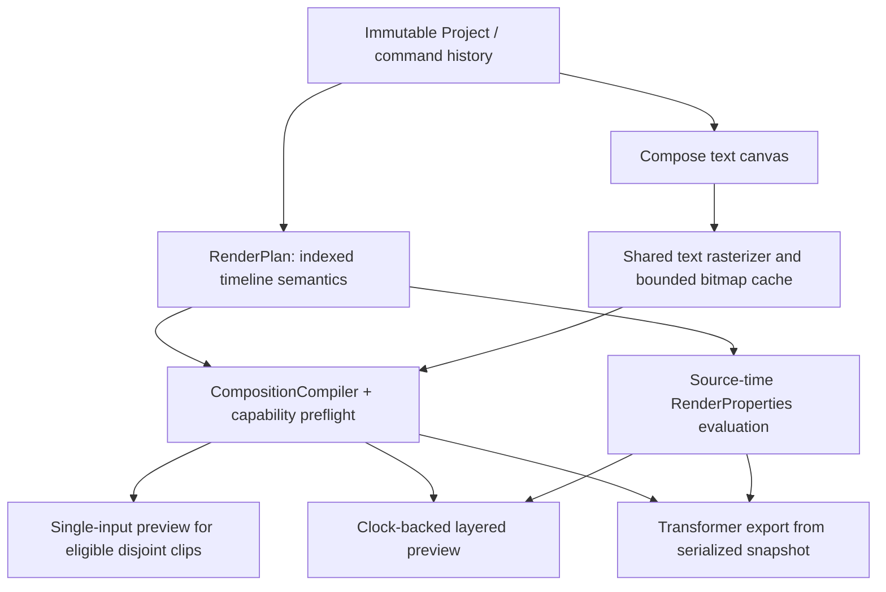

# Rendering foundation phase

Date: 28 October 2026. Baseline: the existing Frame Studio codebase and the prior codebase audit. No schema version change, dependency upgrade, replacement editor, or placeholder feature was introduced.

## 1. What changed

- Added a pure Kotlin derived render plan with indexed track membership, canonical stacking, audio selection, source-time mapping, and evaluated visual transforms.
- Added production brightness, contrast, and saturation through Media3 GL effects, parameter validation, capability preflight, and an ordered color inspector.
- Bound six media transform properties to the compositor at runtime; opacity has actual preview/export pixel tests. No keyframe UI was added.
- Added a two-clip transition scheduling contract. Transition rendering remains explicitly unsupported.
- Fixed still-image trim/split/speed export timing, animated paused seeks, early seeks before the first compositor frame, and layered playback that never reports native end-of-stream.
- Reduced layered playback resets when a layer disappears, retained necessary new-item recovery, and extended the single-input preview optimization to verified color effects.
- Reused derived indexes during recovery, skipped render-neutral edits, and added memory-pressure cache cleanup.

## 2. Files created

Paths below are relative to the repository root.

| File | Purpose |
| --- | --- |
| `core/src/main/kotlin/com/bbvideoeditor/core/RenderPlan.kt` | Plan/indexes, frame state, transform evaluation, effect parameter definitions, capability errors, transition scheduling |
| `core/src/test/kotlin/com/bbvideoeditor/core/RenderPlanTest.kt` | Timing, layers, keyframes, validation, persistence/history, transitions |
| `app/src/main/java/com/bbvideoeditor/app/editor/ColorEffectsInspector.kt` | Ordered effect draft, amounts, enable/disable, reorder, remove, Apply/Cancel |
| `app/src/test/java/com/bbvideoeditor/app/render/RenderCapabilitiesTest.kt` | Shared preflight and capability contracts |
| `app/src/androidTest/java/com/bbvideoeditor/app/render/EffectRenderingTest.kt` | Actual exported/preview pixels and error parity |
| `app/src/androidTest/java/com/bbvideoeditor/app/editor/ColorEffectsInspectorTest.kt` | UI-to-command binding, undo/redo, cancellation |
| `RENDERING_FOUNDATION_PHASE_REPORT.md` | This report |

## 3. Files modified

- `core/.../Project.kt`: overflow-safe keyframe interpolation; serialized representation unchanged.
- `app/.../render/CompositionCompiler.kt`: consume/reuse the plan, validate capabilities, normalize still timing, compile real effects, evaluate compositor transforms.
- `app/.../render/RenderEffectRegistry.kt`: production effect creation, validation and capability preflight.
- `app/.../playback/PreviewEngine.kt`: canonical indexes, plan reuse, render-neutral edit detection, narrower boundary recovery, animated/startup seek recovery, logical end handling.
- `app/.../editor/EditorScreen.kt`: selected visual clip's Color inspector and ordinary `UpdateClip` command.
- `app/.../export/ExportCoordinator.kt`: background preflight before the foreground service starts; validation failures enter the existing failure state.
- `app/.../render/TextRasterizer.kt`: synchronized cache misses and cache clearing.
- `app/.../render/TimelineTextOverlay.kt`: release its owned transparent bitmap after GPU overlay release.
- `app/.../EditorApplication.kt`: clear initialized text/thumbnail/waveform caches under memory pressure/background trimming.
- `app/src/androidTest/.../render/PreviewCompilationTest.kt`: assert normalized still timing instead of assuming virtual source clipping executes in the image loader.
- `app/src/androidTest/.../render/PreviewContinuityTest.kt`: layered boundary pixels/reset counts, real color-effect continuity, naturally advancing opacity, logical end.

## 4. Final rendering architecture



`Project` remains the only editable document. `RenderPlan` contains derived ordering/indexes and references the immutable snapshot; it is not persisted and has no editing API. Preview retains at most one applied plan alongside the pending project. Runtime effects and audio processors are recreated per compilation and are not shared with export. Main-thread player operations retain generation/cancellation guards.

## 5. Shared semantics and geometry order

The compiler uses the same plan and per-item compilation for both executors. The compositor evaluates the same property function for both. Specifically:

- Visual tracks are registered top first by reversing the project visual-track order. Text remains a separate painter-order stack above media.
- Membership is half-open `[startUs, endUs)`, using binary-search track indexes. Missing layers have alpha zero; the empty canvas is black.
- Muting suppresses audio, not visual content. Track locks affect editing, not rendered visibility.
- Audio remains in dedicated unmuted sequences, with explicit gaps, source clipping, speed correction and gain. Visual color effects are not compiled again onto these audio sequences.
- Videos retain source microsecond clipping and `ClipSpeedProvider` split-tail correction. Stills have no decoded source clock: they now emit exactly `clip.durationUs` at speed 1, without a virtual source start. Their original virtual source range/speed still drives keyframes through `Clip.sourceTimeAt`.
- The transparent primary input supplies layered output cadence. Original layer tracks remain predeclared, including gaps; there is no per-clip decoder graph expansion.
- Canonical current order: decoder orientation/tone mapping → canvas scale-to-fit → stored clip-effect order → compositor scale, counterclockwise rotation, normalized translation and opacity → media compositing → text overlay stack.
- Color effects currently operate on the fitted item, including its letterbox area. That is deliberate existing pipeline ordering, and is identical in both executors. Crop, mirror and fill are not implemented; a future source-geometry stage belongs before fit, with parity tests before exposure.

The editor's Compose text adapter and export's native overlay adapter remain separate. Their shared rasterization/static geometry and existing pixel tests are preserved. This phase does not claim to replace those adapters with a single renderer.

## 6. Effect system

Existing `EffectSpec` is unchanged: stable `type`, unique instance ID, ordered parameter map values, property bindings, and enabled flag. Execution order is the clip's list order; duplicate types are valid distinct instances. The inspector appends effects and can reorder, disable or remove individual entries. Apply creates one undo entry; Cancel changes nothing. Effects persist through existing project JSON and survive split/duplicate commands.

`ColorAdjustments` provides the shipped parameter definitions. `RenderEffectRegistry` validates known keys, finite values and ranges, reports capabilities, and constructs actual Media3 effects. Invalid values are rejected; only slider input is constrained by its declared range. No renderer-side silent clamp is used. Omitted `amount` means neutral zero. Unknown enabled effects fail; disabled unknown specs are deliberately retained and shown by the inspector rather than deleted.

The existing custom factory seam is retained. Custom registrations conservatively require the compositor and must provide equivalent preview/export behavior; production built-ins explicitly allow single-input execution. Runtime instances are graph-owned. Effect parameter animation is advertised as unsupported and rejected, rather than storing values that would be ignored. A future factory receives the original clip/media and can use the source-time evaluation contract; it must validate and implement both adapters before enabling that capability.

Preflight is run before media access in compilation and before export service startup. Structured failures distinguish `UnsupportedEffect`, `InvalidEffectParameter`, `UnsupportedAnimatedProperty`, and `UnsupportedTransition`. Existing decoder/encoder errors retain native Media3 error names and messages. This is not a new device decoder-capacity probe: unavailable codecs/concurrent decoder exhaustion can still surface at runtime; existing export encoder checks remain in place.

## 7. Implemented effects

| Concept / stable type | `amount` range | Default | Rendering technology | Preview and export |
| --- | --- | --- | --- | --- |
| Brightness / `brightness` | -1 to +1 | 0 | Media3 `Brightness` RGB matrix, adds a channel offset | Same per-item effect; single-input or compositor preview; Transformer export |
| Contrast / `contrast` | -1 to +1 | 0 | Media3 `Contrast` RGB matrix about mid-gray | Same factory and parameter meaning; -1 produces middle gray |
| Saturation / `saturation` | -100 to +100 | 0 | Media3 `HslAdjustment.adjustSaturation` GL shader | Same factory; -100 removes saturation; values are additive HSL adjustment, not a multiplier |

Output uses the existing SDR/tone-mapping policy. No HDR mastering claim is made. These are GPU rendering operations, not CPU bitmap substitutes.

## 8. Multitrack preview: measurements and limitations

Previously every active visual ID change, including a disappearing overlay, caused seek → release → compile → prepare → resume. The full timeline already existed in stable sequences, so this was a Media3 recovery strategy, not an intentional structural edit.

Experiments were performed on the pinned Media3 1.11.1 implementation:

1. Removing all natural-boundary resets produced a stale red frame after the timeline cut to blue at roughly 2.19 seconds. It retained one player but was visually wrong. The experiment was rejected.
2. Skipping only disappearing layers preserved their pixel behavior. The fixture also exposed failure to reach native EOS. Restoring all old resets reproduced that EOS failure, establishing that it was not caused solely by the reset reduction.
3. The final implementation pauses layered transport when the native clock reaches the canonical project duration, even if native `STATE_ENDED` never arrives. Replay remains driven by project position and the existing seek-to-start path.
4. Natural disappearance now uses compositor alpha without rebuilding. A new active item still triggers recovery. In the four-second, two-overlay fixture, the reset count is **3 instead of 5**. Pixel checks verify both appearances, both disappearances and the base-video cut.
5. Color-adjusted disjoint clips now use the single-input optimization, with actual parity and continuity checks. An early apparent parity failure was traced to the still-image duration bug, fixed, then retested.

Player recreation still occurs for new active visual items in layered playback, cross-segment layered seeks, seeks into animated media, seeks before the first compositor frame, layered graph edits, graph-mode changes and lifecycle resume after release. Static in-clip scrubbing retains its existing path. Single-input sequences retain their player across natural cuts/gaps. Metadata/lock-only changes no longer compile a graph.

The local 1.11.1 source confirms `MultipleInputVideoGraph.flush()` only flushes preprocessors; it does not clear compositor queues. Video prewarming control is package-private. No reflection, private API override, one-decoder-per-clip strategy, or Media3 fork was introduced. The public [CompositionPlayer guide](https://developer.android.com/media/media3/transformer/compositionplayer) still describes multi-video-sequence preview as active development. Public guidance is context; the pixel failures and reset measurements above are this session's direct evidence.

**Layered playback is improved, not seamless.** New-item boundaries can still rebuffer. The 40% reset reduction is specific to this fixture and is not a general throughput benchmark.

## 9. Keyframe foundation

Runtime media bindings: `opacity`, `translationX`, `translationY`, `scaleX`, `scaleY`, `rotationDegrees`. Values replace the matching static transform component. Keyframes use absolute source microseconds, including clip trim, speed and fractional split offset. Existing HOLD/LINEAR interpolation remains authoritative; the arithmetic now avoids intermediate Float overflow between finite endpoints.

Bindings are validated once before execution: unknown/duplicate properties and invalid opacity/nonpositive scale endpoints fail explicitly. Evaluation occurs at compositor presentation timestamps without project traversal or per-frame validation/sorting. Core tests cover all bindings, before/exact/between/after keyframes, HOLD/LINEAR and split/trim preservation. Opacity additionally has actual rendered preview/export tests and natural playback checks.

No keyframe UI is exposed. Text animation, audio automation and effect parameter animation remain rejected. Animated paused seeks currently rebuild the layered graph because otherwise Media3 retained the preceding opacity frame; this is correct but not suitable for a polished keyframe scrub UX yet.

## 10. Transition foundation

`TransitionWindow.schedule` resolves two distinct visual clips, an explicit overlap starting at the incoming clip, duration bounds, and deterministic clamped progress. It requires both source clips throughout the window; no source handles, implicit ripple or hidden duration changes are invented. Tests cover valid progress and insufficient/self overlap.

This is scheduling infrastructure only. No transition factory is registered. All persisted transition specs still fail with `UnsupportedTransition` in both paths. Cross dissolve and transition UI were deliberately not implemented: same-track adjacency currently prohibits overlap and needs an explicit editing/handle policy plus a two-input implementation.

## 11. Performance and threading

- Plan construction/index sorting and graph compilation run on `Dispatchers.Default`; media readability and clock-asset file work run on IO. Export preflight moved off Main and inside the existing error boundary.
- Preview uses compiler-derived indexes instead of rebuilding a separate track index on Main for every project change.
- Boundary recovery reuses the same snapshot's plan. Effects/processors stay fresh; no unsafe reuse of native graph resources.
- Metadata/lock edits skip graph compilation. Existing text-only gesture optimization is preserved, with capability guards to prevent unsupported text data bypassing preflight.
- Disappearance avoids recovery; color-only disjoint clips qualify for the cheaper single-input path.
- The 60 ms edit coalescing and generation checks remain; stale compilations cannot replace the latest player.

Compilation still constructs sequences, checks enabled capabilities and checks used media URIs during recovery. Color Apply rebuilds the graph rather than changing shaders live. No sustained 100-clip, 4K, 1080p multilayer, or 30–60 minute performance claim is made.

## 12. Memory/resources

Text cache remains bounded to 32 MiB; synchronized misses avoid concurrent duplicate rasterization. Eviction removes ownership and never recycles bitmaps still held by Compose/GL. Android trimming clears initialized text, thumbnail and waveform caches. The overlay-owned transparent bitmap is recycled after native overlay release. No frame cache, full decoded-video retention, per-frame bitmap generation, unbounded plan cache or Activity reference was introduced.

Native surfaces/decoders/effects retain existing lifecycle ownership. Preview and export own separate runtime resources. History remains bounded to 100 snapshots. On-demand later-caption rasterization can still occur on the render thread; this is an existing scalability risk, not solved by prewarming two clips.

## 13. Tests added and strengthened

- Core: active visual/audio state, half-open boundaries, ordering/muting, source mapping, all transform bindings, interpolation endpoints/HOLD/LINEAR, split/trim behavior, finite arithmetic, effect range errors, JSON/history/order/enabled state, transition overlap/progress.
- App JVM: built-in capability parity, unknown/disabled effects, unsupported animated parameters/text/audio, transition rejection before media work.
- Real output: brightness changes luminance; contrast minimum reaches middle gray; saturation removes chroma against a chromatic control; reversed effect order changes output; split images preserve effects/timing; gaps are black. Actual SurfaceView pixels are compared with decoded exported H.264 frames in forward and reverse seek order (28-channel-value tolerance for encoding/display/timing differences).
- Opacity: trim plus 2x speed, interpolation/HOLD and overlay gaps in encoded output and preview; natural playback checks changing opacity and terminal transport state.
- Continuity: real effect on a sped-up clip, existing video/image/gap sequences, layered appearance/disappearance/base cuts, exact recovery counts, clock and buffering assertions.
- Inspector: real `EffectSpec` values via slider, Apply as one undo entry, redo, and cancellation.
- Existing suites remain included: commands, timeline math, text, persistence/import, waveforms, gestures, lifecycle, export output and foreground-service cancellation/publication.

## 14. Complete build/test results

Final verification and intermediate failures are summarized below. Temporary logs and diagnostic artifacts were removed after validation to keep the change set focused on code, tests, and this report.

- Initial host JDK 25 invocation failed during Gradle configuration (`25.0.2`). All subsequent runs explicitly use the project's JDK 17.
- Initial baseline emulator run stopped after the existing trim gesture test, with an empty failure and incomplete instrumentation results. Subsequent runs are the usable validation evidence; the initial failure is retained rather than classified as an application regression without evidence.
- Full no-reset and partial-reset experiments failed as described above. Still timing and animated seek failures were investigated and fixed.
- Focused corrected run: **11/11 instrumentation tests passed**, plus JVM suites, in 1m 32s Gradle wall time.

| Final check | Result |
| --- | --- |
| Core JVM tests | **39 passed**, 0 failed/skipped |
| App JVM tests | **14 passed**, 0 failed/skipped |
| Full final instrumentation suite | **36 passed**, 0 failed/skipped; **163.687 seconds**, direct AndroidJUnitRunner |
| Existing text-editor suite, isolated diagnosis | **4 passed**, 20.46 seconds |
| Debug APK and test APK | Built; installed and used by the final full suite |
| Minified release APK | Built successfully, unsigned; not runtime-tested as a release build |
| Android lint | **0 errors, 26 warnings** |
| Whitespace/conflict check | `git diff HEAD --check` passed |

Final build command (JDK 17):

```sh
JAVA_HOME=/Library/Java/JavaVirtualMachines/temurin-17.jdk/Contents/Home ./gradlew \
  :core:test :app:testDebugUnitTest :app:assembleDebug :app:assembleDebugAndroidTest \
  :app:assembleRelease :app:lintDebug --console=plain
```

This succeeded in **3m 40s**. The 26 lint warnings are 13 UseKtx, 7 GradleDependency, 3 NewerVersionAvailable, and one each of OldTargetApi, DataExtractionRules and UsableSpace. Kotlin also reports deprecation warnings for older trim-level constants/volume icons and existing redundant conditions.

The combined Gradle build/instrumentation attempt stopped during the caption UI test after four passes, with incomplete runner output. No app crash was found in the captured crash buffer (a Bluetooth system-service abort was present); the cause remains unproven. All four text tests subsequently passed in isolation, and **all 36 tests passed together against the final APKs** after the build finished. No test was disabled, skipped or weakened to turn that runner interruption into a pass.

Final test invocation, after installing the debug and Android-test APKs:

```sh
adb shell am instrument -w -r com.bbvideoeditor.app.test/androidx.test.runner.AndroidJUnitRunner
```

The final direct runner reported `OK (36 tests)` in 163.687 seconds. The older generated Gradle connected-test HTML/XML reflects the interrupted run, not this final successful run. Raw logs and APK hashes are not retained in version control; the commands above reproduce the checks.

Artifacts: [debug APK](app/build/outputs/apk/debug/app-debug.apk), [unsigned release APK](app/build/outputs/apk/release/app-release-unsigned.apk), [lint report](app/build/reports/lint-results-debug.html).

## 15. Regressions found/fixed

The most consequential pre-existing issue found was image duration normalization: `ImageAssetLoader` queues timestamps from `EditedMediaItem.durationUs`, so applying nonzero virtual source clipping did not produce the intended still duration. Split stills could delay later export content while metadata-only graph tests passed. The compiler now lowers stills directly to timeline duration, and rendered tests protect the result.

Other exercised fixes: stale animated paused-seek frames; seeking before the first compositor frame; layered transport continuing after project end; effect factory work incorrectly applied to separate audio compilation; unsupported text data bypassing the editor's text-only native-graph optimization; Float overflow during interpolation. Failed continuity approaches were removed or narrowed before final validation.

## 16. Remaining risks

One ARM64 Android 17/API 37 emulator is the device evidence. Physical-device GPU/codec behavior, older APIs, HDR/VFR/rotation variants, 4K and long projects still need a matrix. Multi-input Media3 remains experimental and needs recovery at new items and animated seeks. The final-frame stop uses the project/native clock, not a guarantee that every final decoded frame was presented. Effect and geometry pixel comparisons are representative fixtures, not exhaustive media conformance. Text remains two adapters, with existing regression evidence. Cache clearing does not imply immediate reclamation of pinned GPU/UI resources.

## 17. Still not implemented

Cross dissolve or any rendered transition; keyframe editing UI; animated effect parameters; text animation; audio automation; crop/mirror/flip UX or renderer stages; blur/sharpen/vignette/grain; LUTs; chroma key; masks; exposure/temperature/tint/highlights/shadows/fade/vibrance; proxies; device-specific decoder-budget preflight; seamless arbitrary multitrack playback; 4K/long-project certification. No buttons claiming these capabilities were added.

## 18. Recommended next development phase

Build a Media3-independent multi-input timing conformance suite with moving frame IDs, audio sync markers, exact seek/end tests and physical-device coverage. Use it to evaluate an upstream Media3 fix or a separately scoped compositor backend before a keyframe/transition UX. Then define overlap/source-handle editing semantics and implement one two-input dissolve through that tested path. The current plan, parameter validation, source-time evaluator, and pixel tests provide the shared contract for that work.
